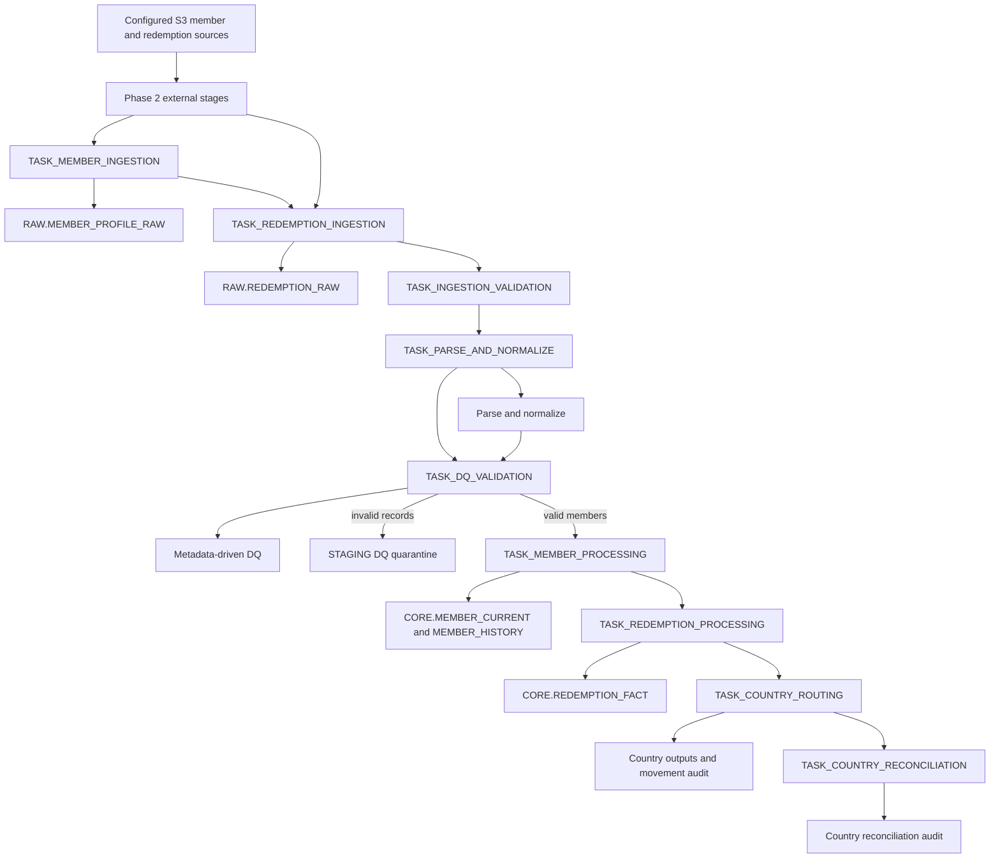

# SkyPoints ETL architecture

The pipeline loads member and redemption sources from the configured S3
locations into immutable raw tables, parses and normalizes the source data,
applies metadata-driven data-quality rules, and sends invalid records to
quarantine. Valid records feed the current/history member tables and
redemption fact table. Country routing materializes approved member-country
outputs, and reconciliation audits the routing results. The 20-country
allowlist and invalid-destination preservation rules are defined by the
country-processing SQL and are not changed by orchestration.

## Unified Phase 3-6C task graph

Phase 7 controls the existing nine-task graph below. Every task depends on
successful completion of the preceding task; there are no scheduled or
event-driven task starts in this graph. The unified runner resumes descendants,
manually triggers the root, waits for the graph, records its outcome, and
suspends the graph after success or failure.

The Phase 3 ingestion-only graph consists of the first three tasks. Phase 4-5
adds parsing, DQ, and business processing; Phase 6 adds country routing and
reconciliation. Phase 7 is the preferred end-to-end entry point because it
coordinates all nine tasks, prevents overlapping controlled runs, and records
the graph run ID and final outcome. The standalone Phase 3, Phase 4-5, and
Phase 6 scripts remain available for phase-specific operation.

## Object ownership and operations

- DCM definitions under `sources/definitions/` manage the declared project
  infrastructure. The existing `SKYPOINTS_DB` database and parent `AUDIT`
  schema are outside DCM management.
- Standalone scripts under `sql/01_ingestion/` create pipes and support
  explicit load/validation operations.
- Task/procedure deployment, execution, and read-only monitoring scripts are
  grouped under the numbered `sql/` directories. Deployment order and commands
  are in [`../sql/README.md`](../sql/README.md) and
  [`runbook.md`](runbook.md).
- Audit and checkpoint rows are retained across executions. A later stage
  failure does not roll back earlier committed tasks or raw ingestion.
